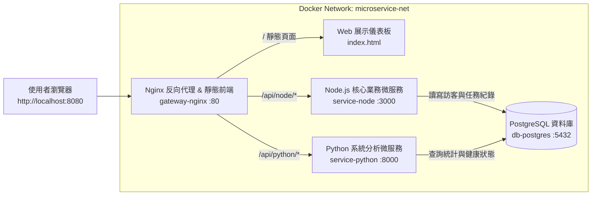

# Docker 學習記錄與多語言微服務系統實作

本專案包含兩大部分：第一部分為 **Docker 核心觀念與指令學習記錄**，整理從映像檔管理、容器生命週期到網路與資料持久化的實作筆記；第二部分為 **Docker 微服務系統建置**，採用 **Nginx + Node.js + Python + PostgreSQL** 四容器微服務架構，並提供視覺化 Web 監控與互動介面。

## 第一部分：Docker 學習記錄與實作筆記

### 1. Docker 核心元件觀念整理

在學習與實作 Docker 的過程中，核心概念可歸納為以下五個要素：

| 核心元件 | 觀念說明 | 在本專案中的實際應用 |
| :--- | :--- | :--- |
| **Image（映像檔）** | 唯讀的應用程式模板，包含程式碼、執行環境、函式庫與設定檔，採分層（Layer）儲存架構。 | 使用官方 `nginx:1.27-alpine`、`postgres:16-alpine`，並透過 `Dockerfile` 自建 Node.js 與 Python 微服務映像檔。 |
| **Container（容器）** | Image 的執行實例（Instance），具備獨立的檔案系統與網路命名空間，與宿主機共用 OS Kernel，啟動快速且輕量。 | 系統啟動後同時運行 4 個獨立容器：`gateway-nginx`、`service-node`、`service-python`、`db-postgres`。 |
| **Dockerfile** | 用來定義如何自動化打包 Image 的腳本檔，透過每一行指令（`FROM`、`WORKDIR`、`COPY`、`RUN`、`CMD`）建立映像層。 | 分別為 Node.js 與 Python 服務撰寫專屬 `Dockerfile`，利用快取機制先安裝依賴套件再複製原始碼，加速建置速度。 |
| **Volume（資料卷）** | 將容器內的特定目錄掛載至宿主機硬碟，解決容器刪除後資料消失的問題，實現資料持久化（Persistence）。 | 建立具名資料卷 `pg_data` 掛載至 PostgreSQL 容器的 `/var/lib/postgresql/data`，確保重啟容器後資料庫紀錄不遺失。 |
| **Network（虛擬網路）** | 提供容器之間安全隔離的通訊管道，在同一自訂 Bridge 網路中的容器可直接透過「服務名稱（Service Name）」進行 DNS 解析互連。 | 建立 `microservice-net` 內部網路，讓 Nginx 與後端服務直接以 `http://service-node:3000`、`db:5432` 通訊，無須將資料庫暴露至外部。 |

### 2. Docker 基礎與進階指令練習記錄

在建置系統前，透過以下指令完成映像檔拉取、容器互動、日誌除錯與資源清理的操作練習：

| 操作分類 | 實作指令 | 用途與學習心得記錄 |
| :--- | :--- | :--- |
| **環境檢查** | `docker --version` / `docker info` | 確認 Docker Engine 與 Client 版本，並檢查目前運行中的容器數量與系統資源配置。 |
| **映像檔管理** | `docker pull nginx:alpine` / `docker images` | 從 Docker Hub 拉取輕量化的 Alpine 版本映像檔，體積僅數十 MB，大幅減少下載時間與磁碟佔用。 |
| **手動建置映像檔** | `docker build -t my-node-service:v1 ./services/node-api` | 讀取目錄下的 `Dockerfile` 進行打包；學會使用 `.dockerignore` 排除 `node_modules`，避免將本地套件複製進容器。 |
| **啟動與背景執行** | `docker run -d -p 8080:80 --name test-web nginx:alpine` | `-d` 代表背景執行（Detached mode），`-p 宿主機Port:容器Port` 負責將外部流量映射至容器內部。 |
| **狀態與資源監控** | `docker ps -a` / `docker stats` | `docker ps` 查看運行中容器與健康狀態（Health Status）；`docker stats` 即時監控各容器的 CPU 與記憶體使用率。 |
| **日誌查詢與除錯** | `docker logs -f service-node` | 當後端連線資料庫失敗時，透過 `-f` 持續追蹤容器標準輸出（stdout/stderr），快速定位連線參數或語法錯誤。 |
| **進入容器內部** | `docker exec -it db-postgres psql -U postgres -d microdb` | 使用互動模式（`-it`）直接進入 PostgreSQL 容器內部執行 SQL 查詢，驗證資料表是否成功建立與寫入。 |
| **多容器編排管理** | `docker compose up -d --build` / `docker compose down -v` | 透過單一 `docker-compose.yml` 一鍵建置並啟動所有微服務；加 `-v` 可在關閉時一併清除測試用 Volume。 |

### 3. 學習過程常見問題與排錯心得（Troubleshooting）

* **問題一：後端容器啟動速度比 PostgreSQL 快，導致啟動瞬間連線失敗**
  * **原因分析**：`docker-compose` 的 `depends_on` 預設只等待容器「啟動（Started）」，而不等待 PostgreSQL 完成內部初始化並準備好接受連線（Ready）。
  * **解決方案**：在 `db` 服務設定 `healthcheck`（使用 `pg_isready` 指令定期檢查），並在後端服務的 `depends_on` 設定 `condition: service_healthy`，確保資料庫完全就緒後才啟動 Node.js 與 Python 微服務。
* **問題二：修改程式碼後執行 `docker compose up` 卻沒有更新內容**
  * **原因分析**：Docker Compose 預設會重複使用已存在的 Image，不會自動重新編譯 `Dockerfile`。
  * **解決方案**：在啟動指令加上 `--build` 參數（`docker compose up -d --build`），強制重新建置有變更的微服務映像檔。
* **問題三：容器內部的服務監聽 `127.0.0.1` 導致外部或 Nginx 無法連線**
  * **原因分析**：每個容器有自己獨立的 Loopback 介面，若後端綁定 `127.0.0.1`，則只有該容器自己能連上。
  * **解決方案**：將 Node.js 與 Python 伺服器監聽位址皆改為 `0.0.0.0`，允許來自 Docker 內部網路（`microservice-net`）的請求進入。

## 第二部分：Docker 微服務系統架構與實作

### 1. 系統架構設計

本系統採用標準微服務反向代理架構，包含 4 個容器服務，統一由 Nginx 作為單一入口（API Gateway & Web Server），後端同時整合 **Node.js** 與 **Python** 兩個獨立微服務，並共用 **PostgreSQL** 資料庫：



### 2. 各微服務職責說明

| 容器名稱 | 技術堆疊 | 服務職責與 API 端點 |
| :--- | :--- | :--- |
| **gateway-nginx** | Nginx 1.27 Alpine | 對外監聽 `8080` Port，提供前端 Web 展示介面，並將 `/api/node/` 與 `/api/python/` 反向代理至對應後端微服務容器。 |
| **service-node** | Node.js 20 Alpine + Express + `pg` | 負責核心資料寫入與任務管理：提供 `/api/node/health`（回傳 Node 容器 Hostname 與連線狀態）與 `/api/node/logs`（新增與讀取系統互動紀錄）。 |
| **service-python** | Python 3.12 Slim + FastAPI + `psycopg2` | 負責系統指標統計與資料分析：提供 `/api/python/stats`（回傳 Python 容器 Hostname、運行時間與 PostgreSQL 統計報表）。 |
| **db-postgres** | PostgreSQL 16 Alpine | 儲存系統訪客打卡與微服務呼叫紀錄，啟動時透過 `/docker-entrypoint-initdb.d/init.sql` 自動初始化資料表與預設資料。 |

### 3. 專案目錄結構

```text
docker-microservices-demo/
├── README.md
├── docker-compose.yml
├── db/
│   └── init.sql                 # PostgreSQL 初始化資料表與種子資料
├── nginx/
│   ├── nginx.conf               # Nginx 反向代理路由設定
│   └── html/
│       └── index.html           # 簡易 Web 展示介面（微服務監控與互動儀表板）
└── services/
    ├── node-api/
    │   ├── Dockerfile           # Node.js 微服務建置檔
    │   ├── package.json
    │   └── server.js            # Express API 伺服器
    └── python-api/
        ├── Dockerfile           # Python 微服務建置檔
        ├── requirements.txt
        └── main.py              # FastAPI 分析伺服器
```

### 4. 核心設定檔內容與解析

#### (1) `docker-compose.yml`

負責統籌定義 4 個容器、環境變數、健康檢查、資料卷與內部網路：

```yaml
services:
  db:
    image: postgres:16-alpine
    container_name: db-postgres
    restart: unless-stopped
    environment:
      POSTGRES_USER: ${POSTGRES_USER:-dockeruser}
      POSTGRES_PASSWORD: ${POSTGRES_PASSWORD:-dockerpass}
      POSTGRES_DB: ${POSTGRES_DB:-microdb}
    volumes:
      - pg_data:/var/lib/postgresql/data
      - ./db/init.sql:/docker-entrypoint-initdb.d/init.sql:ro
    networks:
      - microservice-net
    healthcheck:
      test: ["CMD-SHELL", "pg_isready -U $${POSTGRES_USER:-dockeruser} -d $${POSTGRES_DB:-microdb}"]
      interval: 5s
      timeout: 5s
      retries: 5

  node-api:
    build:
      context: ./services/node-api
      dockerfile: Dockerfile
    container_name: service-node
    restart: unless-stopped
    environment:
      PORT: 3000
      DB_HOST: db
      DB_PORT: 5432
      DB_USER: ${POSTGRES_USER:-dockeruser}
      DB_PASSWORD: ${POSTGRES_PASSWORD:-dockerpass}
      DB_NAME: ${POSTGRES_DB:-microdb}
    depends_on:
      db:
        condition: service_healthy
    networks:
      - microservice-net

  python-api:
    build:
      context: ./services/python-api
      dockerfile: Dockerfile
    container_name: service-python
    restart: unless-stopped
    environment:
      PORT: 8000
      DB_HOST: db
      DB_PORT: 5432
      DB_USER: ${POSTGRES_USER:-dockeruser}
      DB_PASSWORD: ${POSTGRES_PASSWORD:-dockerpass}
      DB_NAME: ${POSTGRES_DB:-microdb}
    depends_on:
      db:
        condition: service_healthy
    networks:
      - microservice-net

  nginx:
    image: nginx:1.27-alpine
    container_name: gateway-nginx
    restart: unless-stopped
    ports:
      - "8080:80"
    volumes:
      - ./nginx/nginx.conf:/etc/nginx/conf.d/default.conf:ro
      - ./nginx/html:/usr/share/nginx/html:ro
    depends_on:
      - node-api
      - python-api
    networks:
      - microservice-net

volumes:
  pg_data:

networks:
  microservice-net:
    driver: bridge
```

#### (2) Node.js 微服務 `services/node-api/Dockerfile`

採用 `node:20-alpine` 輕量基底映像檔，先複製 `package.json` 安裝依賴以善用 Docker Layer Cache，並以非 root 使用者（`node`）執行提升安全性：

```dockerfile
FROM node:20-alpine

WORKDIR /app

COPY package.json ./
RUN npm install --omit=dev

COPY server.js ./

USER node
EXPOSE 3000

CMD ["node", "server.js"]
```

#### (3) Python 微服務 `services/python-api/Dockerfile`

採用 `python:3.12-slim` 基底映像檔，設定 `PYTHONDONTWRITEBYTECODE=1` 與 `PYTHONUNBUFFERED=1` 讓容器日誌即時輸出：

```dockerfile
FROM python:3.12-slim

ENV PYTHONDONTWRITEBYTECODE=1
ENV PYTHONUNBUFFERED=1

WORKDIR /app

COPY requirements.txt ./
RUN pip install --no-cache-dir -r requirements.txt

COPY main.py ./

EXPOSE 8000

CMD ["uvicorn", "main:app", "--host", "0.0.0.0", "--port", "8000"]
```

### 5. 系統啟動與驗證步驟

1. **一鍵建置並啟動所有微服務容器**：
   ```bash
   docker compose up -d --build
   ```
2. **檢查容器運行狀態**：
   ```bash
   docker compose ps
   ```
   確認 `gateway-nginx`、`service-node`、`service-python` 與 `db-postgres` 皆顯示為 `Up`（且 `db-postgres` 顯示 `healthy`）。
3. **開啟簡易 Web 展示介面**：
   打開瀏覽器前往 `http://localhost:8080`，即可在儀表板上看到：
   * **Nginx 反向代理狀態**與即時路由測試
   * **Node.js 微服務容器資訊**（顯示即時 Container ID / Hostname）與新增資料庫留言互動表單
   * **Python FastAPI 微服務容器資訊**（顯示即時 Container ID / Hostname、Python 版本與資料庫統計數據）
   * **PostgreSQL 資料庫即時紀錄清單**（驗證跨容器讀寫與資料持久化）
4. **關閉與清理環境**：
   ```bash
   docker compose down
   ```

---

## 實機執行驗證紀錄

> 執行時間：2026-10-16  
> 環境：Windows 11 + Docker Desktop 4.95.0 + WSL2

### `docker compose up -d --build` 建置輸出

```
✔ Image postgres:16-alpine     Pulled   28.0s
✔ Image nginx:1.27-alpine      Pulled   19.0s
✔ Image hw6-node-api           Built    44.6s
✔ Image hw6-python-api         Built    44.6s
✔ Network hw6_microservice-net Created  0.0s
✔ Volume hw6_pg_data           Created  0.0s
✔ Container db-postgres        Healthy  6.7s
✔ Container service-python     Started  6.3s
✔ Container service-node       Started  6.3s
✔ Container gateway-nginx      Started  6.5s
```

### `docker compose ps` 容器狀態

```
NAME             IMAGE                COMMAND                   SERVICE      CREATED         STATUS                   PORTS
db-postgres      postgres:16-alpine   "docker-entrypoint.s…"   db           9 minutes ago   Up 9 minutes (healthy)   5432/tcp
gateway-nginx    nginx:1.27-alpine    "/docker-entrypoint.…"   nginx        9 minutes ago   Up 4 minutes             0.0.0.0:8080->80/tcp, [::]:8080->80/tcp
service-node     hw6-node-api         "docker-entrypoint.s…"   node-api     9 minutes ago   Up 9 minutes             3000/tcp
service-python   hw6-python-api       "uvicorn main:app --…"   python-api   9 minutes ago   Up 9 minutes             8000/tcp
```

### `docker images` 映像檔清單

```
IMAGE                   ID             DISK USAGE   CONTENT SIZE
hw6-node-api:latest     42f384223820        212MB         51.3MB
hw6-python-api:latest   86986fba27d7        251MB         60.3MB
nginx:1.27-alpine       65645c7bb6a0       74.5MB         21.9MB
postgres:16-alpine      721873c34ceb        420MB          117MB
```

### API 端點測試結果

#### `GET /api/node/health` → 200 OK
```json
{
  "status": "healthy",
  "service": "Node.js Express API",
  "container_id": "24f98d19b8a0",
  "node_version": "v20.20.2",
  "db_time": "2026-10-16T03:15:26.723Z"
}
```

#### `GET /api/python/stats` → 200 OK
```json
{
  "status": "healthy",
  "service": "Python FastAPI Analytics",
  "container_id": "de95b1b9808a",
  "python_version": "3.12.15",
  "total_records": 3,
  "breakdown": [
    { "service_name": "Python Service", "count": 1 },
    { "service_name": "Node.js Service", "count": 1 },
    { "service_name": "System Init", "count": 1 }
  ]
}
```

#### `GET /api/node/logs` → 200 OK
```json
[
  { "id": 3, "service_name": "Python Service", "author": "FastAPI Worker", "message": "Python 分析微服務已就緒，開始監控容器指標。", "created_at": "2026-10-16T03:10:06.892Z" },
  { "id": 2, "service_name": "Node.js Service", "author": "Express API", "message": "Node.js 微服務已連線至 PostgreSQL cluster。", "created_at": "2026-10-16T03:10:06.892Z" },
  { "id": 1, "service_name": "System Init", "author": "PostgreSQL", "message": "資料庫容器初始化完成，資料表建立成功！", "created_at": "2026-10-16T03:10:06.892Z" }
]
```

### 驗證結論

| 項目 | 結果 |
| :--- | :--- |
| 4 個容器全數啟動 | ✅ 通過 |
| db-postgres Healthcheck (pg_isready) | ✅ healthy |
| Node.js API `/api/node/health` | ✅ 200 OK |
| Python API `/api/python/stats` | ✅ 200 OK |
| PostgreSQL 初始種子資料讀取 `/api/node/logs` | ✅ 3 筆正確回傳 |
| Nginx 反向代理 `/api/node/` → service-node:3000 | ✅ 正常 |
| Nginx 反向代理 `/api/python/` → service-python:8000 | ✅ 正常 |
| pg_data Volume 資料持久化 | ✅ 已掛載 |