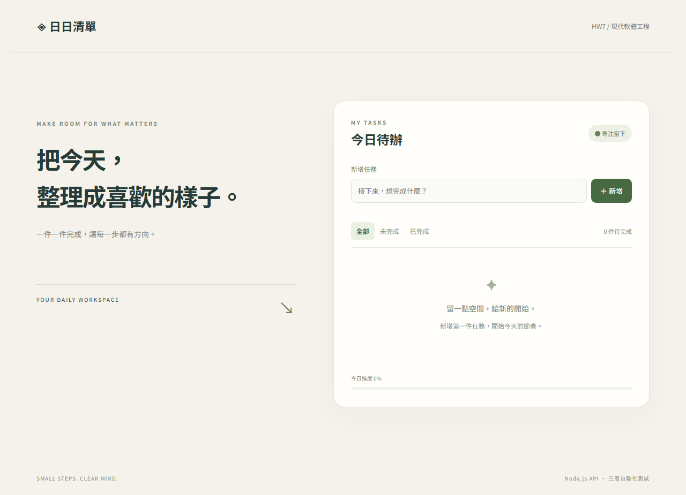
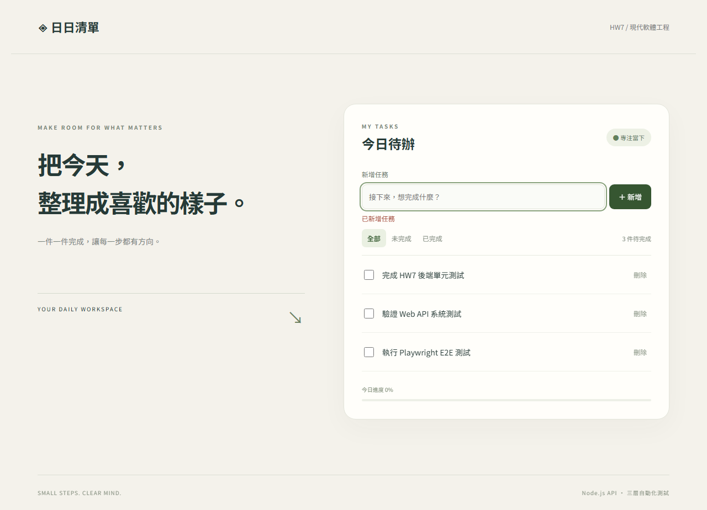
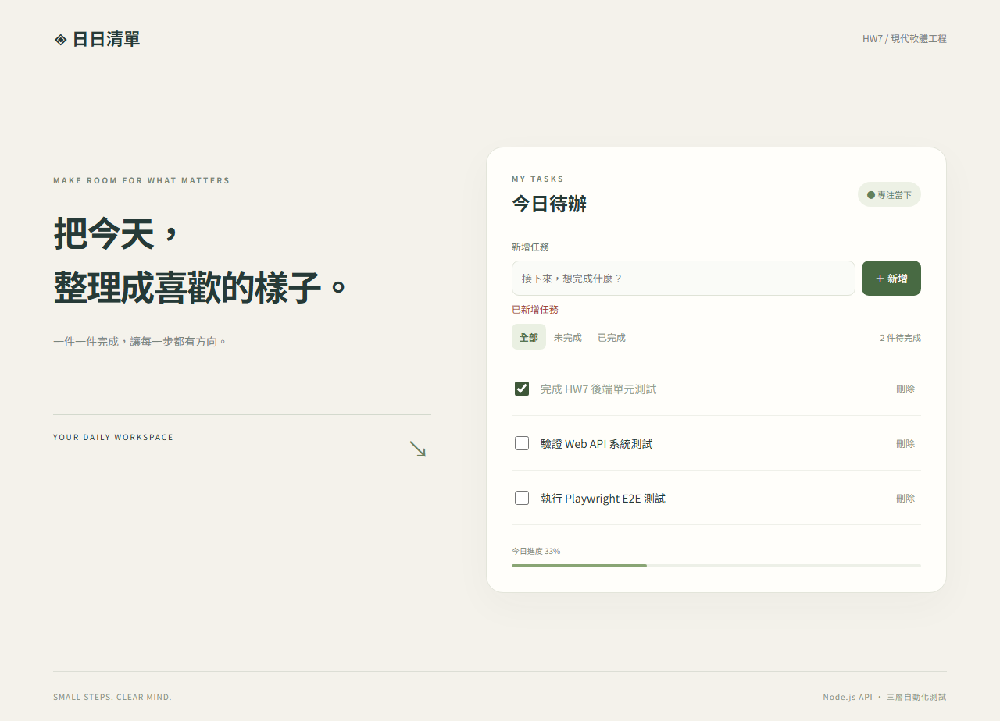
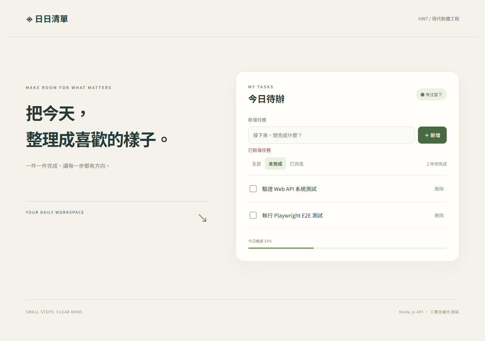
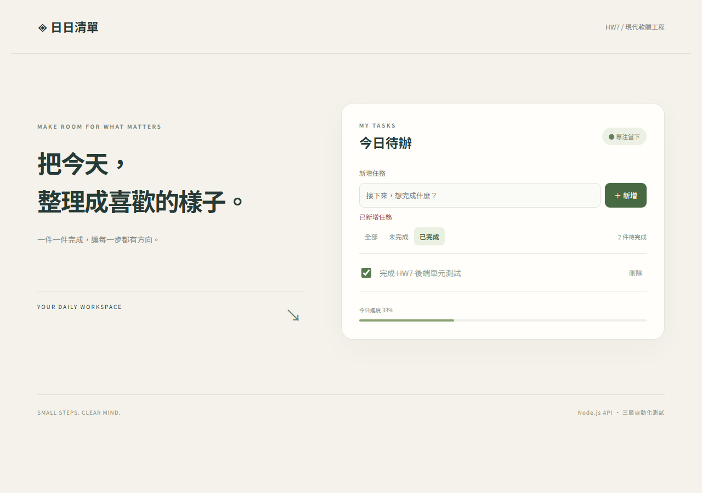
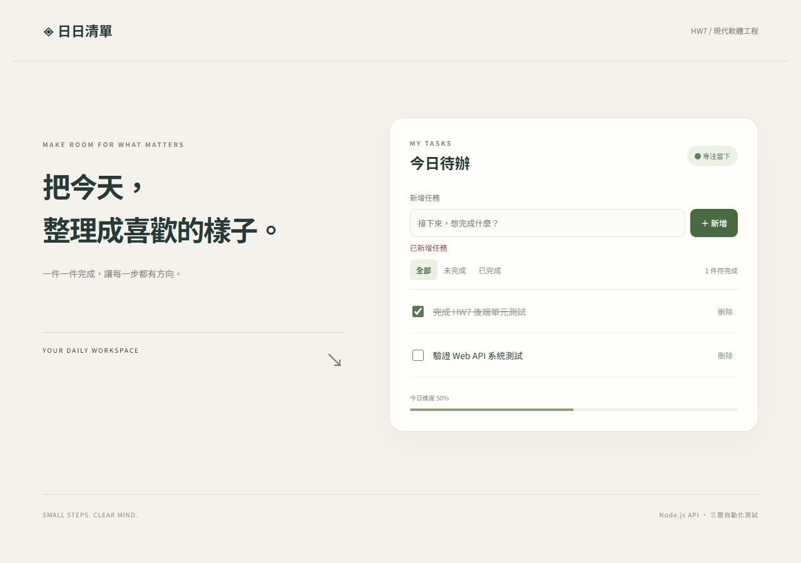
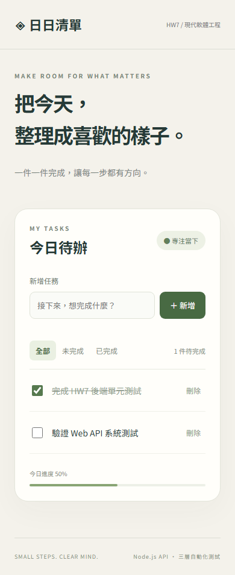

# HW7：日日清單與三層自動化測試

現代軟體工程作業：可新增、勾選完成、篩選、刪除任務的網站應用。

## 網站功能與操作截圖

本網站在本機執行。以下為使用 Chromium 實際操作後擷取的畫面，老師不需啟動網站，也能直接在 README 查看介面與操作結果。圖片使用儲存庫內的相對路徑，將 `HW7` 連同 `docs/screenshots/` 一起上傳 GitHub 即可顯示，不依賴本機網址。

### 1. 首頁與空清單

剛進入網站時，右側顯示「今日待辦」、新增任務欄位、三種篩選按鈕，以及 0% 的今日進度；清單尚無任務時顯示空狀態提示。



### 2. 新增任務

在「新增任務」欄位輸入名稱，按「＋ 新增」。成功後輸入框會清空、顯示「已新增任務」，任務加入清單。本例依序新增三件作業任務，右上角顯示「3 件待完成」。



### 3. 完成任務與進度計算

勾選任務左側的核取方塊，即可標示完成。已完成任務會顯示刪除線，待完成數量降為 2 件，完成 1 / 3 件的進度顯示為 33%。再次取消勾選即可恢復未完成狀態。



### 4. 篩選未完成與已完成任務

按「未完成」只顯示還沒完成的兩件任務；按「已完成」只顯示已勾選的任務。篩選僅改變目前顯示的清單，待完成數量與進度仍依全部任務計算。按「全部」可回到完整清單。

**未完成篩選：**



**已完成篩選：**



### 5. 刪除任務

回到「全部」，按任務右側的「刪除」即可移除該任務。本例刪除「執行 Playwright E2E 測試」後，剩下兩件任務（一件完成、一件未完成），進度隨之更新為 50%。



### 6. 輸入驗證

若名稱只有空白，按新增後會顯示「請輸入任務名稱」，不會建立空白任務。後端也會驗證名稱，拒絕空白、非文字或超過 100 個字元單位的輸入。


### 7. 手機版與重新整理

手機寬度時改為單欄排列，輸入框、篩選與任務操作仍可使用，下圖為 390 × 844 視窗的完整頁面截圖。此畫面先經重新整理，確認前一步剩餘的兩件任務與完成狀態仍存在。正常啟動時，資料另存於 `data/tasks.json`，重啟 server 後仍會保留。



### 截圖重現方式

```powershell
npm.cmd run docs:screenshots
```

此指令需要先依下方安裝步驟安裝套件與瀏覽器。它會啟動獨立、隨機 port 的記憶體 HTTP server，透過實際 UI 操作重建以上 8 張圖片並驗證畫面狀態；完成後自動關閉，不會修改日常使用的 `data/tasks.json`。截圖為作業展示資料，不是使用者的個人任務。

## 三層測試成果

目前已實際執行 `npm.cmd test`，**30 項全部通過**：

| 測試層級 | 通過數 | 實際驗證方式 |
| --- | ---: | --- |
| 後端單元測試 | 11 | 直接驗證後端任務邏輯、輸入規則及檔案儲存 |
| 系統／Web API 測試 | 12 | 啟動真正 HTTP server，發送 API 請求並驗證狀態碼與資料 |
| Playwright E2E | 7 | 使用無頭 Chromium 操作前端並驗證前後端整合 |

詳細案例與執行環境請見 [測試報告](TEST_REPORT.md)，完整輸出請見 [測試執行紀錄](reports/final-test-run.log)。這些截圖展示網站操作，三層測試的結果以測試報告及執行紀錄為準。

## 使用技術

- Server：Node.js 原生 HTTP server，將任務邏輯與 HTTP 路由分離。
- Client：HTML、CSS、原生 JavaScript，響應式繁體中文介面。
- 儲存：正常啟動時使用 `data/tasks.json`，重新啟動仍保留任務。
- 單元測試：Node.js 內建 `node:test` 與 `assert`，測試後端。
- 系統測試：啟動真正的 HTTP server，以 `fetch` 發出 Web API 請求。
- E2E：Playwright + Chromium，明確設定 `headless: true`。

此專案的後端採用 Node.js；Rust 為題目舉例，非本專案使用的語言。前端不另做單元測試，使用 E2E 驗證操作行為。

## 環境與安裝

需要 Node.js 22 以上（建置時使用 Node.js 24）。Windows PowerShell：

```powershell
cd "C:\Users\user\Desktop\現代軟體工程\HW7"
npm.cmd ci
npm.cmd run test:install
```

使用 `.cmd` 可避免 PowerShell 執行政策阻擋 `npm.ps1`。首次安裝需要網路下載套件與瀏覽器。

`test:install` 將 Chromium Headless Shell 存在專案內的 `.browsers/`，測試設定使用相同固定位置，避免不同程序的暫存目錄造成瀏覽器找不到。此目錄已加入 `.gitignore`，換電腦或更新 Playwright 後重新執行安裝指令即可。

## 啟動網站

```powershell
npm.cmd start
```

開啟 <http://127.0.0.1:3000>。終端按 Ctrl+C 關閉。

如 3000 port 已占用，可先執行 `$env:PORT = '3001'` 再啟動。

## 執行三種測試

```powershell
# 全部依序執行；任一階段失敗就停止，並回傳非零退出碼
npm.cmd test

# 也可分開執行
npm.cmd run test:unit
npm.cmd run test:system
npm.cmd run test:e2e

# 開啟 Playwright HTML 測試報告
npm.cmd run test:report
```

| 種類 | 測試位置 | 驗證範圍 | 隔離方式 |
| --- | --- | --- | --- |
| 後端單元測試 | `tests/unit/store.test.js` | 輸入驗證、CRUD、錯誤、資料副本、檔案持久化 | 每例建立獨立 Store；檔案案例使用暫存目錄 |
| 系統／Web API 測試 | `tests/system/api.test.js` | HTTP 狀態碼、JSON、完整 CRUD、錯誤請求、前端資源 | 每例啟動獨立 server 與隨機 port，不使用 HTTP mock |
| E2E 測試 | `tests/e2e/tasks.spec.js` | 空狀態、新增、重整、完成、篩選、刪除、空白驗證、XSS、手機版 | 真正 Chromium 操作 UI，每例先清空測試任務 |

Playwright 透過 `globalSetup` 自動啟動 port **3108** 的獨立 HTTP server，使用記憶體儲存，結束自動關閉；不讀寫正常網站的 `data/tasks.json`。Server 在 runner 內管理，避免 Windows shell 子程序樹的關閉差異；瀏覽器仍經由 TCP/HTTP 連線至完整前後端，沒有 mock。為避免共用資料互相影響，E2E 設定單一 worker。若 3108 已被其他程式占用，測試會明確失敗，不會沿用未知 server。

Playwright 報告放在 `playwright-report/index.html`；失敗時另保存截圖與 trace 到 `test-results/`。報告與依賴已加入 `.gitignore`。

## API 規格

| 方法 | 路徑 | Body | 成功狀態 |
| --- | --- | --- | --- |
| GET | `/api/health` | — | 200：`{"status":"ok"}` |
| GET | `/api/tasks` | — | 200：任務陣列 |
| POST | `/api/tasks` | `{"title":"完成作業"}` | 201：新任務 |
| PATCH | `/api/tasks/:id` | `{"completed":true}` 或 `{"title":"新名稱"}`，可同時提供 | 200：更新後任務 |
| DELETE | `/api/tasks/:id` | — | 204：無內容 |

任務格式：`{"id":1,"title":"完成作業","completed":false}`。

名稱去除前後空白後須為 1–100 個 JavaScript UTF-16 字元單位；`completed` 須為布林值。錯誤格式為 `{"error":"說明"}`，包含 400（驗證失敗）、404（不存在）、405（不支援的方法）、413（內容過大）。請求 Body 上限為 16 KiB。

## 專案結構

```text
HW7/
├── server/
│   ├── index.js          # 啟動與儲存設定
│   ├── app.js            # HTTP 路由、靜態檔案及錯誤回應
│   └── store.js          # 任務邏輯、驗證、JSON 持久化
├── public/
│   ├── index.html
│   ├── style.css
│   └── app.js
├── tests/
│   ├── unit/store.test.js
│   ├── system/api.test.js
│   └── e2e/              # tasks.spec.js 與 setup.js
├── docs/screenshots/     # README 使用的 8 張實際操作截圖
├── scripts/
│   ├── install-browser.js
│   └── capture-screenshots.js
├── playwright.config.js
├── package.json
├── package-lock.json
├── TEST_REPORT.md
└── README.md
```

## 設計與限制

這是本機單人作業展示，無登入功能，server 僅綁定 `127.0.0.1`。檔案儲存適用於單一 server 程序，不支援多程序同時寫入。E2E 中的重新整理案例驗證 UI 與 server 資料一致；server 重啟後的持久化由後端檔案儲存單元測試驗證。頁面用 `textContent` 顯示任務名稱，避免將輸入解析成 HTML。

Playwright 設定參考官方文件：
- https://playwright.dev/docs/test-global-setup-teardown
- https://playwright.dev/docs/test-use-options
