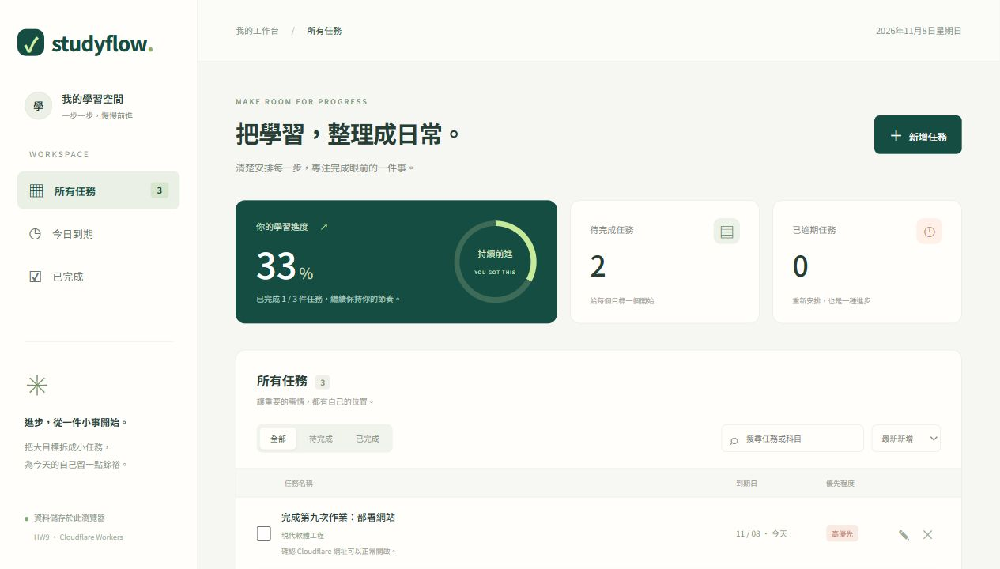

# Cloudflare 部署紀錄

- 日期：2026-11-08（Asia/Taipei）
- 網址：https://hw9-studyflow.hw9-studyflow.workers.dev
- Worker：`hw9-studyflow`
- 版本：`e56e7be1-2b74-421b-9283-b5efe924a103`
- 方式：Cloudflare 官方 Wrangler，`wrangler deploy`
- 平台結果：已上傳 5 個靜態資源，Worker 與 triggers 部署成功。

## 檢查結果

- JavaScript 語法檢查通過。
- 5 項資料邏輯測試全部通過。
- `wrangler deploy --dry-run` 通過。
- 本機瀏覽器功能操作及桌面／手機排版驗證完成，截圖見 README。
- 正式 HTTPS 已於 2026-11-08 03:46（Asia/Taipei）驗證回傳 200 OK。首次 TLS 等待已解除。
- 已用瀏覽器開啟正式網址並成功載入範例任務，確認 JavaScript 與互動正常。
- Cloudflare deployments list 確認上述版本承接 100% 流量。

## 後續更新

```powershell
cd "C:\Users\user\Desktop\現代軟體工程\HW9"
npm.cmd ci
npm.cmd run deploy
```

Cloudflare 登入憑證由官方 Wrangler 保管於使用者設定目錄，未放入專案。



