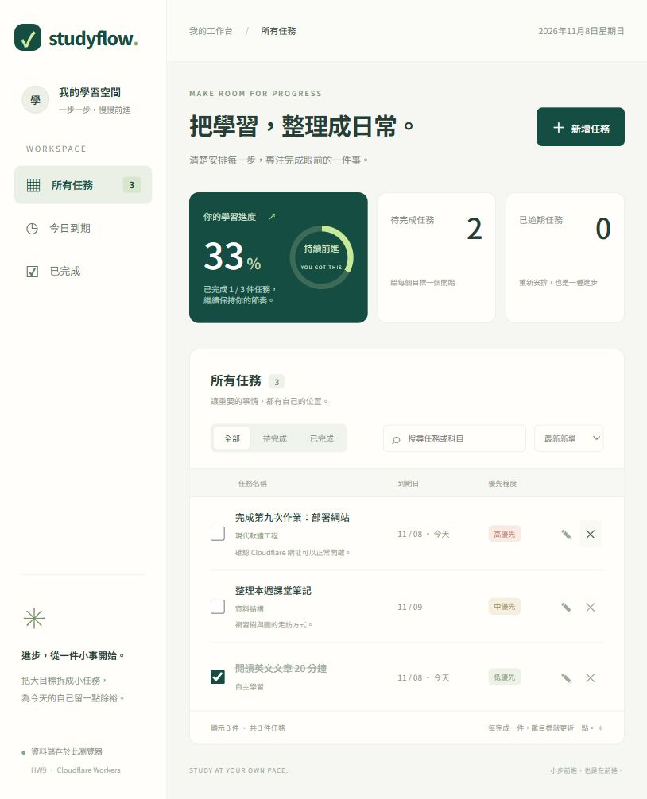
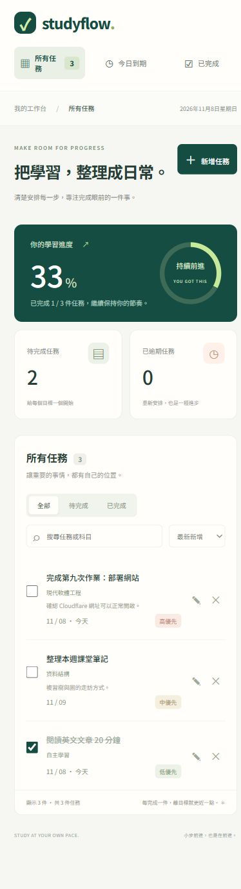

# HW9：Studyflow 學習任務管理

繁體中文網站應用，使用 Cloudflare Workers Static Assets 部署。原生 HTML、CSS 與 JavaScript，不需要前端建置步驟。

正式網址：[開啟 Studyflow](https://hw9-studyflow.hw9-studyflow.workers.dev)。部署紀錄與 HTTPS 驗證狀態請見 [DEPLOYMENT.md](DEPLOYMENT.md)。

## 功能

- 新增、編輯、完成／取消完成與刪除任務；刪除前確認。
- 科目、到期日、三種優先程度與備註。
- 所有任務、今日到期、已完成檢視；狀態篩選、科目／名稱搜尋、期限／優先程度排序。
- 完成進度、待完成數與逾期統計；期限依瀏覽器當地日期判定。
- 響應式介面、鍵盤操作、表單驗證及儲存錯誤提示。
- 初始空清單，按「載入範例」可建立 3 件展示任務。

任務保存在目前網站來源的 `localStorage`，重新整理或關閉瀏覽器後通常仍保留。資料不會上傳到 Cloudflare，也不會跨裝置、跨瀏覽器或跨網址同步；清除網站資料會移除任務。無登入與伺服器資料庫。請勿將瀏覽器儲存視為重要資料的唯一備份。

## 本機執行

需要 Node.js 22 以上。Windows PowerShell：

```powershell
cd "C:\Users\user\Desktop\現代軟體工程\HW9"
npm.cmd ci
npm.cmd run dev
```

開啟終端顯示的本機網址（預設 `http://localhost:8787`），Ctrl+C 停止。使用 `.cmd` 避免 PowerShell 執行政策阻擋 npm。

## 部署到 Cloudflare

```powershell
npx.cmd wrangler login
npm.cmd run deploy
```

在瀏覽器登入自己的 Cloudflare 帳號並允許官方 Wrangler 授權，部署完成後終端會輸出實際 `https://hw9-studyflow.<帳號子網域>.workers.dev` 網址。不要自行把這個格式當成已部署網址。

`wrangler.jsonc` 指定 Worker 名稱 `hw9-studyflow` 與靜態資源目錄 `public`；可在 Cloudflare 控制台 Workers & Pages 查看部署。重新發布修改同樣執行 `npm.cmd run deploy`。若名稱已被同帳號其他專案使用，先改為獨特的名稱，避免覆蓋其他網站。

官方部署文件：[Workers Static Assets](https://developers.cloudflare.com/workers/static-assets/get-started/)、[Wrangler 設定](https://developers.cloudflare.com/workers/wrangler/configuration/)。

## 驗證

```powershell
npm.cmd run check
npm.cmd test
npx.cmd wrangler deploy --dry-run
```

- JavaScript 語法檢查通過。
- 5 項 Node.js 測試通過：輸入驗證、日期驗證、資料還原與損壞資料防護、組合篩選、排序、當地日期。
- 已透過實際瀏覽器操作確認範例載入、新增、編輯、勾選完成、搜尋、重新整理保留資料、確認刪除。
- 已檢查桌面與 390 × 844 手機版畫面。以下為本機預覽截圖，不代表正式部署證明。





## 專案結構

```text
HW9/
├── public/
│   ├── index.html       # 介面與新增／編輯對話框
│   ├── style.css        # 桌面與手機版樣式
│   ├── app.js           # DOM 操作、互動與本機儲存
│   ├── model.js         # 資料驗證、篩選與排序
│   ├── _headers        # 安全回應標頭
│   └── 404.html
├── tests/model.test.js
├── docs/               # 實際瀏覽器截圖
├── wrangler.jsonc      # Cloudflare Workers 設定
├── package.json
├── package-lock.json
└── README.md
```

字型使用 Google Fonts Noto Sans TC；無法載入外部字型時自動使用系統字型。任務文字以 `textContent` 呈現，不解析使用者輸入的 HTML。`_headers` 設定 CSP、拒絕 iframe 嵌入與 MIME 猜測防護。

